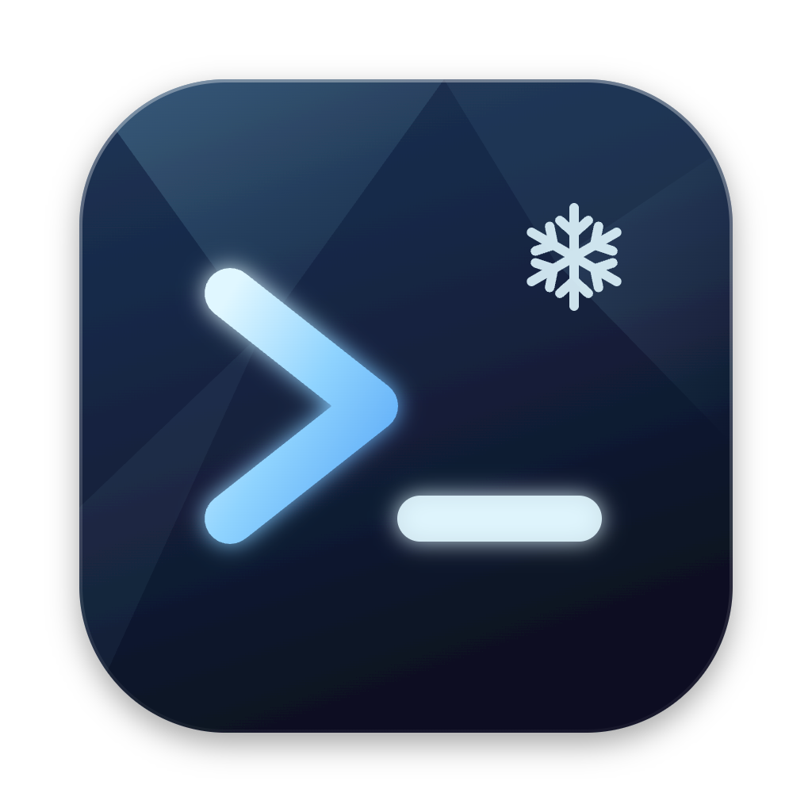

<p align="center"></p>

# Glaceon Terminal

A fast, keyboard-driven terminal for macOS (Apple silicon), built with Electron, xterm.js 6 (WebGL)
and node-pty. Everything is TypeScript, split into layers that can be tested without Electron.

## Features

- **Tabs and split panes** — binary split tree, divider dragging, directional navigation, zoom,
  equalize, keyboard resizing. New panes start in the current pane's directory.
- **Tab tools** — rename, colors, pin, lock, groups, drag to reorder, drag a pane onto another to
  split or swap, tiling layouts (columns, rows, grids, main + stack) that keep running shells.
- **Windows** — multiple windows, tear-off, moving tabs between windows with the shell, its
  scrollback and its pid intact.
- **Quake terminal** — a drop-down window on a global shortcut (default ⌃\`), on every Space and
  above full-screen apps, on the screen the pointer is on.
- **Command palette** for every command, theme and layout.
- **Search** in the scrollback with case, regex and whole-word modes.
- **Clickable paths and stack traces** (`file:line:col`, `file://` URLs, Node, Python and tsc traces) open in
  your editor with ⌘-click; URLs open in the browser.
- **Process monitor and job tracker** — what is running in every pane, CPU and memory, and
  SIGINT/SIGTERM for whole process trees.
- **Snippets** with `{{name}}` / `{{name:default}}` placeholders filled in one form, and a
  **clipboard ring** of the last 10 copies.
- **7 themes** (Tokyo Night, Catppuccin Mocha, Dracula, Nord, Gruvbox Dark, One Dark, Solarized
  Dark) and a theme editor with a live preview.
- **Settings** in a commented JSON file that reloads live, plus a settings window that edits the
  same file without losing your comments. Every keybinding can be remapped.

## Install

Requires Node 24 and pnpm 10.

```sh
pnpm install
pnpm --filter @glaceon/desktop package:dmg   # apps/desktop/dist.noindex/Glaceon Terminal-<version>-arm64.dmg
pnpm package                                 # just the .app, in apps/desktop/dist.noindex/mac-arm64/
```

The build is unsigned, for personal use. The first time, open it with right-click → Open.

## Configuration

| File                              | What                                                   |
| --------------------------------- | ------------------------------------------------------ |
| `~/.config/glaceon/config.json`   | Settings and keybindings (JSONC; written on first run) |
| `~/.config/glaceon/snippets.json` | Snippets: `[{ "name", "body", "description"? }]`       |

Invalid JSON never wipes your setup: the last valid configuration stays active and a banner shows
the problem. `GLACEON_CONFIG_DIR` points the app at another directory.

```jsonc
{
  "theme": "catppuccin-mocha",
  "fontSize": 14,
  "copyOnSelect": true,
  "editorCommand": "code -g {file}:{line}:{col}",
  "keybindings": [
    { "key": "cmd+e", "command": "pane.splitRight" },
    { "key": "", "command": "-tab.next" }, // "-" removes a default binding
  ],
}
```

## Keyboard

| Action                           | Keys                 |
| -------------------------------- | -------------------- |
| New tab / window                 | ⌘T / ⌘N              |
| Close pane / tab / window        | ⌘W / ⌘⌥W / ⌘⇧W       |
| Split right / down               | ⌘D / ⌘⇧D             |
| Move between panes               | ⌘⌥ + arrows, ⌘[ / ⌘] |
| Zoom pane                        | ⌘⇧↩                  |
| Equalize / resize panes          | ⌘⌃= / ⌘⌃ + arrows    |
| Previous / next tab, go to tab   | ⌘⇧[ ⌘⇧] ⌃⇥, ⌘1–9     |
| Command palette                  | ⌘⇧P                  |
| Find / next / previous           | ⌘F / ⌘G / ⌘⇧G        |
| Settings                         | ⌘,                   |
| Clear                            | ⌘K                   |
| Font size                        | ⌘= ⌘- ⌘0             |
| Clipboard ring / snippets / jobs | ⌘⇧V / ⌘⇧S / ⌘⇧J      |
| Quake terminal (global)          | ⌃\`                  |

## Development

```sh
pnpm dev        # run with hot reload
pnpm verify     # typecheck, lint, format check, unit tests, end-to-end tests
pnpm bench      # throughput and latency measurements
pnpm e2e:packaged   # end-to-end tests against the packaged .app
node scripts/build-icon.mjs   # regenerate icon.png / icon.icns from build/icon.svg
```

End-to-end tests drive the real app through Playwright with hidden windows, an isolated `HOME`
and config directory, and `/bin/sh`. They include a 200-pane open/close leak test and a 24-pane
stress test.

### Layout

```
packages/
  domain/          pure model: pane tree, workspace, themes, keybindings, links, snippets
  application/     ports, services, stores and the command registry (no Electron, no DOM)
  contracts/       IPC channels, pty protocol and bridge types, validated with zod
  infrastructure/  adapters: Electron main, pty host (node-pty), renderer (xterm.js)
  ui/              React components that read application stores
apps/desktop/      composition roots for the main, pty-host, preload and renderer processes
```

Dependencies point inward only (enforced by `eslint-plugin-boundaries`). The pty host is a single
utility process; terminal output flows to each window over a `MessagePort` with flow control, so
⌃C stays responsive under heavy output. Windows run sandboxed with context isolation.
